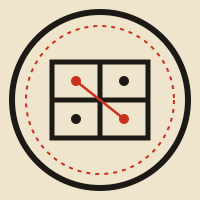

<p align="center"></p>

# Curio

*A cabinet of curiosities.*

A growing collection of small, interactive web experiments: ideas from AI and machine learning made visible and playable, finely made machines you can take apart, physics and mathematics you can poke at, and effects that show off what the browser itself can do. Each piece is a self-contained page that runs entirely in your browser, with no backend and no tracking. Some are explanatory toys, others are generative art; all of them are honest about what is simulated.

**Walk the archive:** https://blackman99.github.io/curio/

The homepage is a museum you can walk around in: the newest exhibit stands under the rotunda's oculus, and the eight galleries around it hold the most recent sixty-four in cases of their own. North of the north gallery, The Stacks keeps a card-catalogue drawer for every exhibit ever shown; filter the drawers by lane and year and pull one to open it. When a ninth gallery fills, it takes the place of the oldest one, whose exhibits stay on in their drawers, so the building never grows. Walk with W A S D (or the arrow keys, the scroll wheel, or the left thumb on a phone), drag to look, click the floor to go there, and click a case or a drawer to open the exhibit. The floor plan and directory in the corner take you to any case; `?list` gives a plain list instead.

## Layout

```
exhibits/<slug>/   one folder per exhibit, everything it needs:
  index.html         the exhibit, a single self-contained page
  og.png             1200×630 social card (the hall hangs a 512 px WebP made from it)
  mini.js            its miniature for the 3D hall: export default function (T, col) → {obj, mats, tick}
  meta.json          title, number, date, kind, blurb, colour, lane (3d / web / science / ml)
assets/            the hall (assets/hall/*.js), three.js, logo, favicon
tools/             build_site.py, check_repo.py, verify_exhibit.py, check_live.py
index.html         the 3D hall and the ?list view
```

The site is built by GitHub Actions (`.github/workflows/pages.yml`): `tools/check_repo.py` checks every exhibit, then `tools/build_site.py` copies each `exhibits/<slug>/` to `/<slug>/`, writes `demos.json` from the `meta.json` files and makes the thumbnails. Pages in `exhibits/` link to `../assets/…` and `../` as they will be served, so open them through the built site. Adding an exhibit means adding one folder.

## Run locally

Everything is static; build the site, then serve it with any HTTP server (needs Pillow for the thumbnails):

```sh
python3 tools/build_site.py          # → _site/
python3 -m http.server 8000 -d _site
# then open http://localhost:8000/
```

## License

[MIT](LICENSE) © Blackman99
